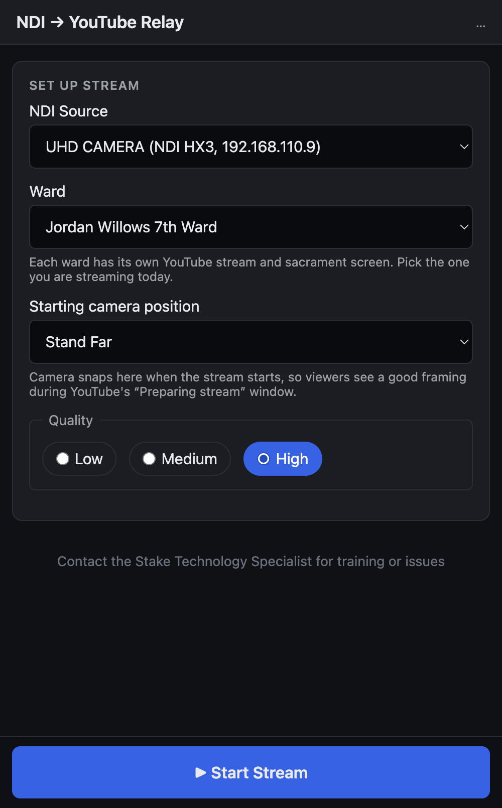
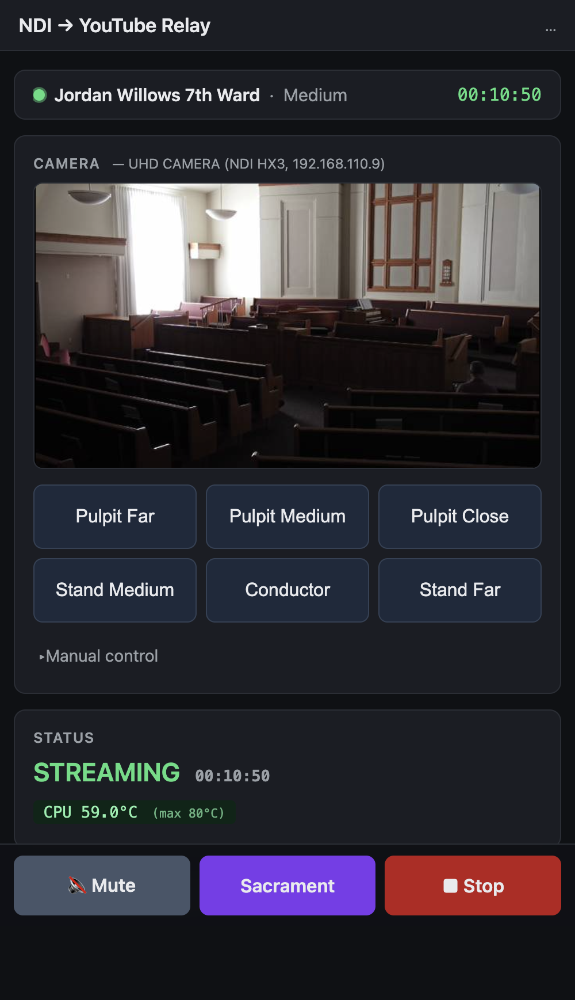
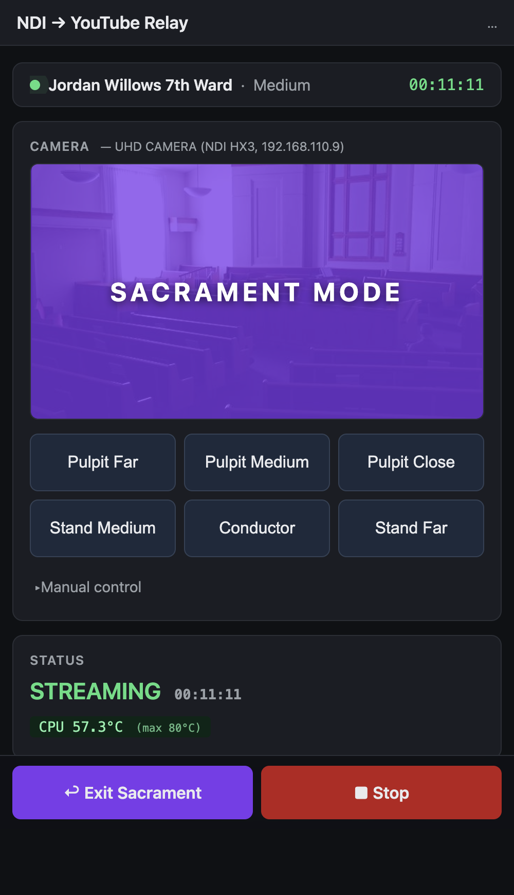
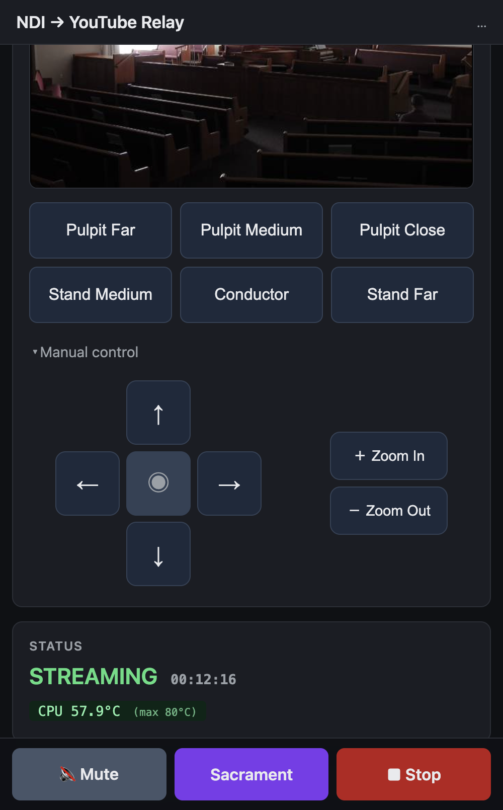

# Operator's Guide — Streaming the Sacrament Meeting

This guide is for the person running the broadcast on the day of the
meeting. You don't need any special software — just a phone, tablet,
or laptop on the building's wifi or ethernet.

If anything in this guide doesn't match what you see, or if something
just isn't working, **contact your Stake Technology Specialist**.

---

## 1. Open the appliance

The streaming appliance is the small black box in the building's tech
closet. It runs by itself — you don't need to touch it. You just open
its web page from any device on the building's network.

Pick the URL for your building:

| Building | URL to type into your browser |
|---|---|
| **South building** — Jordan Willows 1st Ward, Jordan Willows 7th Ward, Snow Springs Ward | `http://snowspringssouth.local/` |
| **North building** — Jordan Willows 2nd Ward, Lehi 25th Ward, Pioneer Crossing Ward, Sommerset Ward | `http://snowspringsnorth.local/` |

> **Doesn't load?** Try refreshing once. If it still doesn't load,
> your device might not be on the building's network — check your
> wifi. If you're sure you're on the right network and the page won't
> come up, contact your Stake Technology Specialist.

---

## 2. What you should see

When you open the page before the meeting starts, it looks like this:



The main things on the page:

- **NDI Source** at the top — the chapel camera. It should already say
  the right camera. If it says "(searching…)" or "(no sources found)",
  the camera is probably off — flip the chapel-camera power switch in
  the tech closet, wait 30 seconds, and refresh the page.
- **Ward** — the ward whose meeting you're about to stream. **This is
  already set for you.** Each building has its own appliance and is
  pre-configured with the wards that meet in it. Only change it if you
  know you're streaming for a different ward today.
- **Starting camera position** — the preset the camera snaps to the
  moment you hit Start, so viewers see a good framing right away
  instead of whatever the camera was last pointed at.
- **Quality** — leave on **high** unless you notice viewers complaining
  about buffering. (More on this below.)
- The big blue **▶ Start Stream** button is pinned to the bottom of the
  screen, always within thumb's reach on a phone.

Nothing else is on this page on purpose — no preview, no camera
controls — so there's nothing to distract you from checking these four
things before you go live.

---

## 3. Start the broadcast

When you're ready to go live on YouTube, click the big blue **▶ Start
Stream** button.

After a few seconds the page switches to the streaming view:



What you'll see:

- A compact bar at the top showing the **ward**, **quality**, and a
  running **uptime clock**, with a pulsing green dot to confirm you're
  live.
- A full-width **camera preview** — this is the same picture YouTube
  viewers see — with the presets grid and a collapsible **Manual
  control** section right below it.
- A **Status** card with the CPU temperature. Green is fine. Yellow
  means watch it. Red means it's overheating (rare — call the Stake
  Tech Specialist).
- The setup form is hidden while you're live, so nothing can be
  accidentally changed mid-meeting. To change source, ward, or the
  starting camera position, stop the stream first.
- **🔇 Mute**, **Sacrament**, and **■ Stop** are pinned to the bottom
  of the screen.

Check your YouTube Studio (on a separate device or tab) and confirm
the broadcast is showing up there. It can take 10–20 seconds for
YouTube to register a new stream.

---

## 4. Sacrament mode

When the deacons stand to begin the sacrament, click the purple
**Sacrament** button. The live camera view is replaced on YouTube by
the ward's sacrament screen, and the audio is silenced. The stream
stays live the whole time — viewers don't see a "reconnecting" gap.



What changes:

- The preview pane shows a large purple **SACRAMENT MODE** banner over
  the camera image. (The camera is still recording in the background —
  YouTube viewers can't see it during sacrament.)
- The button changes to **↩ Exit Sacrament**.

When the sacrament concludes and the closing speakers begin, click
**↩ Exit Sacrament**. The live camera and audio come back instantly.

> **Note:** the sacrament screen is the artwork the ward provided — it
> shows the ward's name and "Sacrament in Progress". If the artwork
> looks wrong (e.g., says the wrong ward), contact your Stake Tech
> Specialist.

---

## 5. Moving the camera

You have two ways to point the camera: presets (recommended) and
manual control.

### Presets

The grey buttons below the preview are **presets** — saved camera
positions for common framings. Click one and the camera smoothly pans
to that position.

Typical presets:

- **Pulpit Far / Medium / Close** — three zoom levels framed on the
  pulpit (use for speakers).
- **Stand Medium / Stand Far** — wider views of the rostrum (use for
  the choir or large groups on the stand).
- **Conductor** — frames whoever is conducting.

**Presets are the easiest way to drive the camera during a meeting.**
Click one before each speaker and the camera does the rest.

### Manual control (for fine-tuning)

If a preset isn't quite right, click **▶ Manual control** under the
preset grid to expand the manual pad:



- **Arrow buttons** — point the camera left, right, up, down.
  **Press and hold** the arrow; the camera moves while you hold and
  stops when you let go. The middle button (◉) is an emergency stop.
- **＋ Zoom In** / **− Zoom Out** — same press-and-hold pattern for
  zoom.

Manual control is for small framing adjustments. For big moves between
speakers, use the presets.

---

## 6. Stop the broadcast

When the meeting is over, click the red **■ Stop** button.

- The broadcast ends on YouTube.
- The page returns to the resting state from step 2.

That's it. You can close the browser tab.

---

## 7. What to do if YouTube viewers complain about buffering

The most common cause is the building's internet being slow that
particular day. The quality knob has three settings you can step
through:

| Setting | Picture quality | Network demand |
|---|---|---|
| **high** *(default)* | 1080p, best | Highest |
| **medium** | 1080p, more compression | Half of high |
| **low** | 360p (lower resolution) | About 10× less than high |

If viewers are buffering on high, click **medium**. If they're still
buffering on medium, click **low** — at low quality almost any working
network can carry the stream.

You can change quality while the stream is running, but it briefly
reconnects on YouTube. Try to change between speakers, not during the
sacrament or a prayer.

---

## 8. Common problems

| Problem | Try this |
|---|---|
| The page doesn't load at all | Check you're on the building's wifi or ethernet. Refresh once. |
| "(no sources found)" in the NDI Source dropdown | Camera is probably off — flip the camera switch and wait 30 seconds. |
| The Start button does nothing / shows a red error banner at the top of the page | Read the message; it usually tells you what to check. If it tells you to contact someone, do that. |
| YouTube shows buffering / "reconnecting" for viewers | Drop quality from high → medium → low (see section 7). |
| The appliance feels slow / temperature chip is red | Stop the stream, wait a few minutes, then try again. If it goes red again immediately, contact the Stake Tech Specialist. |
| Anything weird that this guide doesn't cover | Contact your Stake Technology Specialist. |

---

## Quick reference card

You can print this section and keep it on the appliance.

```
URL (south): http://snowspringssouth.local/
URL (north): http://snowspringsnorth.local/

Before meeting:  open URL → check NDI Source + Ward are right
Start meeting:   click ▶ Start Stream
Sacrament:       click Sacrament when deacons stand
                 click ↩ Exit Sacrament after prayer on water
Camera moves:    click a preset (Pulpit / Stand / Conductor)
End meeting:     click ■ Stop

Buffering on YouTube?  drop quality: high → medium → low
Anything broken?       contact Stake Technology Specialist
```
